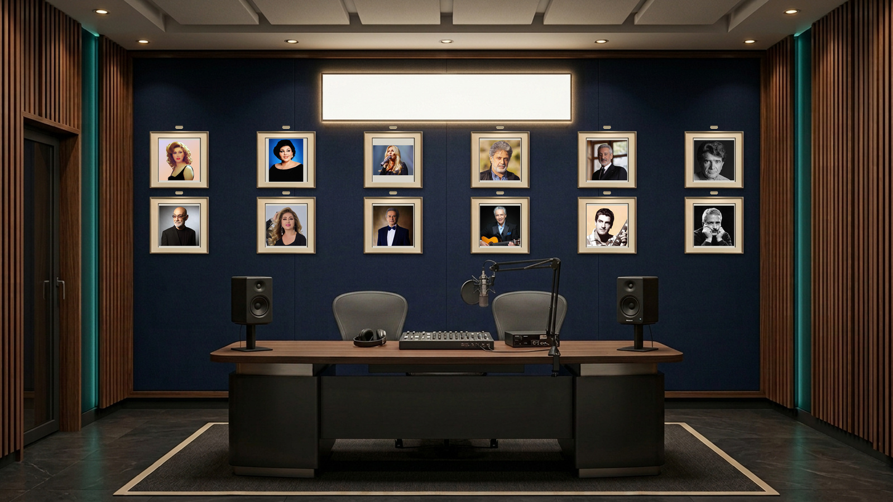

# AHANGBAN SIGNATURE RADIO STUDIO

**Master View 001 — version 1.2 — pending approval of the latest corrections.**

One empty studio with **two host chairs** and **twelve portraits, read right-to-left
within each of two rows**. The illuminated logo panel is intentionally **blank**.
No new camera angle or in-studio presenter image has been generated.

- [Full 4K base PNG](master/MASTER-VIEW-001.png)
- [Fast preview JPG — same view](master/MASTER-VIEW-001-preview.jpg)
- [Original logo as a separate transparent overlay](overlays/AHANGBAN-LOGO-CORE.png)
- [Optional blue glow overlay for later video animation](overlays/AHANGBAN-LOGO-GLOW.png)
- [Permanent Ava and Sajad character references](Presenters/README.fa.md)
- [Persian master specification](MASTER-SPEC.fa.md)
- [Environment lock](environment-lock.json)

The overlays are static layers, not an already animated neon video. Original logo
lettering/colors are preserved. Marks/backgrounds on the presenter reference sheets
are not replacements for the official logo or this studio.

The 4K master is composited from original source photographs and an upscaled
architecture plate, not native 4K image generation. A 2D reference does not guarantee
3D geometric identity across future camera angles; see the specification.

User-provided source artwork belongs to its respective rights holders. No licensing
or real-person identity verification is implied by registering these references.
